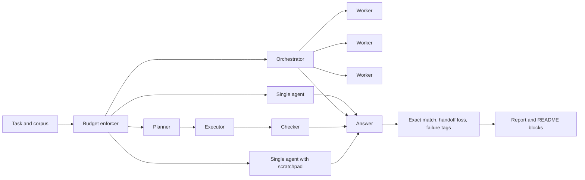

# splitbench

[](https://github.com/shreyas-tech7/splitbench/actions/workflows/ci.yml)

One agent or a team of agents, compared under the same token and tool budget, on research tasks with exact answers.

<!-- splitbench:status -->
**Status:** v0.1.0-rc1. All numbers below come from the scripted model `scripted-v1`, not from an LLM, run on 2026-11-23 with corpus seed 7 on the 40 held-out tasks. No free-model run happened yet, because the build machine had no provider key and its network proxy refused the free providers. The oracle solves 60 of 60 tasks.
<!-- /splitbench:status -->

## The problem

Teams that build agents argue about one question. Should a hard research task go to one agent with one long context, or to a lead agent that splits the work among helpers? Anthropic reports that a multi-agent research system beat a single agent on broad questions. Cognition argues that splitting work loses context between agents and makes systems fragile. Both sides rarely hold the budget fixed, so a team that spends more tokens can look smarter for that reason alone.

splitbench holds the budget fixed. Every design gets the same token cap, the same tool-call cap, the same base prompt and the same two tools. It runs four designs on invented company documents and scores exact answers, so no judge model is needed. It also measures handoff loss: facts that one agent found but that never reached the agent that wrote the answer.

<!-- splitbench:setup -->
- **Corpus:** 301 invented documents about 58 invented companies, from seed 7.
- **Tasks:** 60 with exact answers: 20 breadth, 20 depth and 20 mixed. 20 are for development and 40 are held out.
- **Tight budget:** 10,000 tokens and 20 tool calls per task, shared by every agent in the run.
- **Loose budget:** 45,000 tokens and 40 tool calls per task, shared by every agent in the run.
<!-- /splitbench:setup -->

Tasks come in three shapes:

- **Breadth:** the same fact about every company in a sector or a city, then a sum, a count or a ranking.
- **Depth:** a chain such as "the chief executive of the key supplier of the key supplier of X", where each hop needs the one before it.
- **Mixed:** a breadth task where each company also needs one hop through its supplier.

## How it works



- **Single agent:** one agent searches and reads until it can answer.
- **Orchestrator and workers:** a lead reads the sector or city list, splits the companies among workers, waits for their reports and combines them. A chain goes to one worker, because each hop depends on the last one. The lead is a state machine with the steps plan, dispatch, collect, combine and stop.
- **Pipeline:** a planner writes the steps, an executor runs them and writes the evidence, and a checker confirms or fixes the answer.
- **Single agent with scratchpad:** one agent that keeps only its latest turns and a running list of the facts it found.

The budget enforcer reserves tokens before each model call and cuts the output to what is left, so no design can go over a cap. Workers and pipeline roles get slices of the one shared budget. `tests/test_budget.py` proves it for every design at both levels with a model that tries to spend everything.

## Results

Every row below runs on the held-out tasks only. The budget levels were set on the development tasks before any held-out run (see [DECISIONS.md](DECISIONS.md)). The model is a scripted model that reasons perfectly over whatever is in its own context, so the differences come from what each design lets into each agent's context and what each protocol costs in tokens. "Calls on the critical path" counts the model calls that must happen one after another. It stands in for time, because scripted calls take no real time.

<!-- splitbench:results -->
**Loose budget:** 45,000 tokens and 40 tool calls per task, shared by every agent in the run.

| Architecture | Solved (95% CI) | Breadth | Depth | Mixed | Tokens per task (95% CI) | Tool calls | Calls on the critical path | Handoff loss |
| --- | --- | --- | --- | --- | --- | --- | --- | --- |
| Orchestrator and workers | 100% (91% to 100%) | 13/13 | 13/13 | 14/14 | 13,278 (11,007 to 15,466) | 18.2 | 11.4 | 0% |
| Pipeline | 95% (83% to 99%) | 12/13 | 13/13 | 13/14 | 20,733 (16,746 to 24,483) | 17.5 | 20.5 | 2% |
| Single agent with scratchpad | 100% (91% to 100%) | 13/13 | 13/13 | 14/14 | 18,820 (15,203 to 22,252) | 16.9 | 17.9 | n/a |
| Single agent | 100% (91% to 100%) | 13/13 | 13/13 | 14/14 | 20,332 (15,899 to 24,495) | 16.9 | 17.9 | n/a |

**Tight budget:** 10,000 tokens and 20 tool calls per task, shared by every agent in the run.

| Architecture | Solved (95% CI) | Breadth | Depth | Mixed | Tokens per task (95% CI) | Tool calls | Calls on the critical path | Handoff loss |
| --- | --- | --- | --- | --- | --- | --- | --- | --- |
| Orchestrator and workers | 45% (31% to 60%) | 4/13 | 13/13 | 1/14 | 6,609 (6,234 to 6,942) | 9.6 | 8.5 | 1% |
| Pipeline | 50% (35% to 65%) | 5/13 | 13/13 | 2/14 | 8,218 (7,636 to 8,725) | 10.5 | 13.5 | 3% |
| Single agent with scratchpad | 45% (31% to 60%) | 4/13 | 13/13 | 1/14 | 8,150 (7,560 to 8,655) | 9.4 | 10.4 | n/a |
| Single agent | 50% (35% to 65%) | 5/13 | 13/13 | 2/14 | 7,710 (6,998 to 8,331) | 10.1 | 11.1 | n/a |
<!-- /splitbench:results -->

Each design runs the same tasks as the single agent, so each task gives one paired difference:

<!-- splitbench:paired -->
| Budget | Compared with the single agent | Tasks | Change in solved share (95% CI) | Change in tokens per task (95% CI) |
| --- | --- | --- | --- | --- |
| loose | Orchestrator and workers | 40 | +0 points (+0 to +0) | -7,054 (-9,314 to -4,877) |
| loose | Pipeline | 40 | -5 points (-12 to +0) | +401 (-818 to +1,539) |
| loose | Single agent with scratchpad | 40 | +0 points (+0 to +0) | -1,512 (-2,410 to -623) |
| tight | Orchestrator and workers | 40 | -5 points (-12 to +0) | -1,101 (-1,532 to -660) |
| tight | Pipeline | 40 | +0 points (+0 to +0) | +508 (+313 to +703) |
| tight | Single agent with scratchpad | 40 | -5 points (-12 to +0) | +440 (+259 to +603) |
<!-- /splitbench:paired -->

A rebuild from a second corpus seed tells the same story:

<!-- splitbench:seeds -->
| Budget | Architecture | Seed 7 | Seed 11 |
| --- | --- | --- | --- |
| loose | Orchestrator and workers | 40 of 40 | 40 of 40 |
| loose | Pipeline | 38 of 40 | 38 of 40 |
| loose | Single agent with scratchpad | 40 of 40 | 40 of 40 |
| loose | Single agent | 40 of 40 | 38 of 40 |
| tight | Orchestrator and workers | 18 of 40 | 19 of 40 |
| tight | Pipeline | 20 of 40 | 22 of 40 |
| tight | Single agent with scratchpad | 18 of 40 | 20 of 40 |
| tight | Single agent | 20 of 40 | 22 of 40 |
<!-- /splitbench:seeds -->

### Which design to pick

<!-- splitbench:guide -->
- **Breadth tasks, loose budget:** orchestrator and workers. It solved the same share as the single agent (100%) with 7,606 fewer tokens per task.
- **Depth tasks, loose budget:** single agent (100% solved). No team design solved more or matched it for fewer tokens.
- **Mixed tasks, loose budget:** orchestrator and workers. It solved the same share as the single agent (100%) with 13,765 fewer tokens per task.
- **Breadth tasks, tight budget:** single agent (38% solved). No team design solved more or matched it for fewer tokens.
- **Depth tasks, tight budget:** single agent (100% solved). No team design solved more or matched it for fewer tokens.
- **Mixed tasks, tight budget:** single agent (14% solved). No team design solved more or matched it for fewer tokens.
<!-- /splitbench:guide -->

What the scripted run shows: when the budget is loose, splitting a wide task saves tokens, because each worker carries a short context while one agent carries every document it has read. When the budget is tight, splitting does not help. Each worker gets a small slice, stops early, and the lead combines partial reports. Chains gain nothing from a split, because each hop waits for the one before it.

The full report with failure tags is in [docs/REPORT.md](docs/REPORT.md). A page that opens from disk is in [docs/index.html](docs/index.html).

## Cost per task

<!-- splitbench:cost -->
| Budget | Architecture | Tokens per task | Tokens per solved task | Runs that hit a cap |
| --- | --- | --- | --- | --- |
| loose | Orchestrator and workers | 13,278 | 13,278 | 0 of 40 |
| loose | Pipeline | 20,733 | 21,824 | 2 of 40 |
| loose | Single agent with scratchpad | 18,820 | 18,820 | 0 of 40 |
| loose | Single agent | 20,332 | 20,332 | 0 of 40 |
| tight | Orchestrator and workers | 6,609 | 14,687 | 0 of 40 |
| tight | Pipeline | 8,218 | 16,435 | 2 of 40 |
| tight | Single agent with scratchpad | 8,150 | 18,110 | 0 of 40 |
| tight | Single agent | 7,710 | 15,419 | 0 of 40 |
<!-- /splitbench:cost -->

## Run it in ten minutes

You need Python and [uv](https://docs.astral.sh/uv/). Nothing here needs a key or a network.

```bash
git clone https://github.com/shreyas-tech7/splitbench.git
cd splitbench
./init.sh                          # venv, lint, link check, tests
.venv/bin/splitbench check-frozen  # the corpus and tasks match their digest
.venv/bin/splitbench oracle        # solve every task with the tools and no model
.venv/bin/splitbench run           # all four designs, held-out tasks, both budgets
.venv/bin/splitbench run --corpus-seed 11
.venv/bin/splitbench report        # rewrite the summary, docs/REPORT.md and the README blocks
.venv/bin/splitbench readme --check
```

The run appends to `results/runs-scripted-v1-heldout.jsonl` and skips finished runs, so a stopped run resumes. To record a free model, set a key from `.env.example` and run:

```bash
.venv/bin/splitbench probe
.venv/bin/splitbench run --provider groq --mode record --limit 4
.venv/bin/splitbench run --provider groq --mode replay --limit 4
```

Record mode stores every request and response under `results/cache/`. Replay mode reads only the cache and fails on a request it has not seen. [docs/DEMO.md](docs/DEMO.md) shows a real terminal session.

## Limits

- **No LLM ran yet.** Every number above comes from the scripted model. A free model will make mistakes that the scripted model never makes, such as wrong arithmetic or a malformed action. Record and replay are built and tested against a local fake server, but no free provider answered from the build machine.
- **The scripted model is not a stand-in for a real one.** It reasons perfectly, so it shows the cost of each protocol and the effect of context loss. It cannot show whether a team catches errors that one agent would make.
- **Agents stop early on purpose.** Every role sees the budget left in its prompt and answers with what it has when the budget runs low. So many tight runs fail with tokens to spare, which the cost table shows.
- **Intervals cover task sampling only.** The scripted model has no sampling noise, so a rerun gives the same numbers. The second seed is a rebuild of the corpus, not a second sample of the model.
- **Token counts are estimates.** The harness counts one token for every four characters of the exact prompt and output. Provider counts differ, and record mode logs them next to the harness count.
- **The tasks are invented.** Each fact sits in one clear sentence. Real documents are messier, and search on them is noisier.
- **Parallel time is a proxy.** Workers run in lockstep for the scripted model, so the report counts calls on the critical path instead of seconds.

## Glossary

- **Budget:** the most tokens and tool calls one task may use, shared by every agent in the run.
- **Breadth, depth, mixed:** the three task shapes described above.
- **Handoff loss:** of the needed facts that an upstream agent found in a tool result, the share missing from the final agent's context when it answered.
- **Dropped:** of the same facts, the share missing from the reports or evidence that upstream agents handed on, even if the final agent found them again by itself.
- **MAST groups:** the three failure groups from the MAST study. FC1 is a specification or system design failure, FC2 is a failure between agents, FC3 is a failure to verify or finish. `metrics.mast_tag` gives each failed run one group by fixed rules.
- **Paired difference:** the change for one design against the single agent on the same task, averaged over tasks.
- **Wilson interval:** a confidence interval for a share that behaves well near zero and one.
- **Critical path:** the longest chain of model calls that must run one after another.

## Related work

- Anthropic, [How we built our multi-agent research system](https://www.anthropic.com/engineering/multi-agent-research-system). A lead with parallel subagents beat one agent on broad research, and token use explained most of the gap.
- Cognition, [Don't Build Multi-Agents](https://cognition.ai/blog/dont-build-multi-agents). Splitting work loses context, and shared context matters more than parallel speed. Its [later post](https://cognition.ai/blog/multi-agents-working) reports that a narrower design works, where several agents contribute and one agent writes.
- Cemri and others, [Why Do Multi-Agent LLM Systems Fail?](https://arxiv.org/abs/2503.13657). The MAST taxonomy of failures in multi-agent systems.
- LangChain, [How and when to build multi-agent systems](https://blog.langchain.com/how-and-when-to-build-multi-agent-systems). Both sides agree that context engineering is the core of the problem.

splitbench adds an equal-budget comparison on tasks with exact answers, a direct measure of handoff loss, and a replay cache so anyone can rerun a recorded study for free.

## How this was built

AI agents wrote most of the code under Shreyas's direction. The full build prompt is in [docs/build/BUILD_PROMPT.md](docs/build/BUILD_PROMPT.md). Choices and their reasons are in [DECISIONS.md](DECISIONS.md), and what failed is in [BLOCKERS.md](BLOCKERS.md).

Human checks, not done yet:

- Shreyas has not yet read the code or the results.
- Shreyas has not yet run a free model in record mode.
- Shreyas has not yet checked the README against the result files by hand.

## License

MIT. See [LICENSE](LICENSE).
